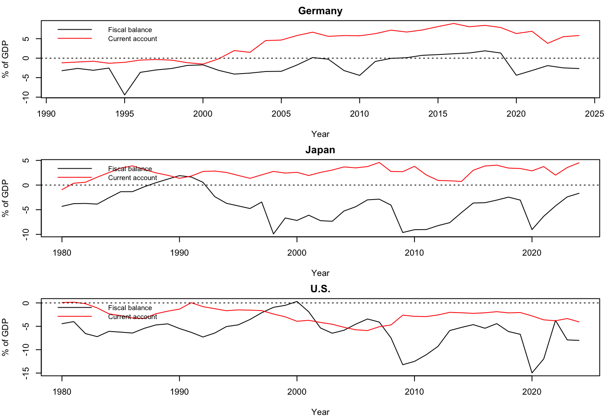
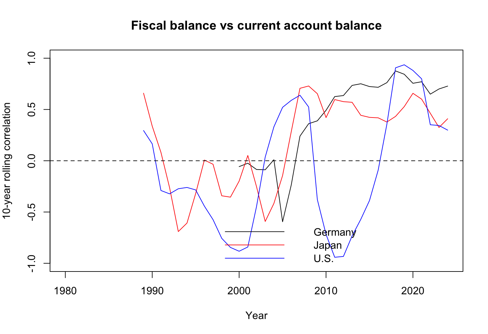

# Twin Deficits: United States, Germany and Japan

R analysis of the **twin deficits hypothesis**: does a larger government deficit go together with a larger current account deficit? The script tests whether the current account balance has a **positive** slope on the fiscal balance (both in % of GDP) for the U.S., Germany and Japan.

- **Script:** `Twin_deficit_Final.R`
- **Language / version:** R 4.5.2
- **Packages:** `tidyr`, `sandwich`, `lmtest`, `tseries`

---

## 1. Variables

| Variable | Definition | Code used in the script |
|---|---|---|
| Fiscal balance (`fd`) | Government net lending (+) / net borrowing (-), % of GDP | `GGXCNL_NGDP` |
| Current account (`ca`) | Current account balance, % of GDP | `BCA_NGDPD` |

Negative fiscal values are deficits. The twin deficits hypothesis predicts a **positive** slope of `ca` on `fd`.

---

## 2. Datasets

Six CSV files are needed, one fiscal file and one current account file for each country. All must be in the folder set as `DIR` in the script, and all use the IMF layout (columns `DATASET`, `SERIES_CODE`, `OBS_MEASURE`, `COUNTRY`, `INDICATOR`, `FREQUENCY`, `SCALE`, then one column per year).

| File | Country | Series code inside file | Source | Years available |
|---|---|---|---|---|
| `Germany FD.csv` | Germany | `DEU.GGXCNL_NGDP.A` | IMF World Economic Outlook (WEO) | 1991-2031 |
| `Germany CA.csv` | Germany | `DEU.BCA_NGDPD.A` | IMF WEO | 1980-2031 |
| `Japan FD.csv` | Japan | `JPN.GGXCNL_NGDP.A` | IMF WEO | 1980-2031 |
| `Japan CA.csv` | Japan | `JPN.BCA_NGDPD.A` | IMF WEO | 1980-2031 |
| `US CA.csv` | United States | `USA.BCA_NGDPD.A` | IMF WEO | 1980-2031 |
| `US FD .csv` | United States | `USA.GGXCNL_NGDP.A` | See below (two options) | 1960-2024 (BEA) or 2001-2031 (IMF) |

IMF files come from the IMF WEO database (dataset tag `IMF.RES:WEO(9.0.0)`, annual, units = % of GDP). Years after 2024 are IMF projections and are removed by the script (`LAST_ACTUAL`).

### U.S. fiscal balance: choose ONE file

The IMF U.S. general government series only starts in 2001, so there are two options. Put **only one** in the folder, because the script stops with a duplicate-data error if both are present.

| Option | Source | Coverage | Notes |
|---|---|---|---|
| **A: IMF** | IMF WEO, `GGXCNL_NGDP`, general government | 2001-2024 | Same source and definition as Germany and Japan. |
| **B: BEA** | U.S. Bureau of Economic Analysis, NIPA "Net lending or net borrowing (-), Government" (FRED series `AD01RC1A027NBEA`), divided by nominal GDP x 100 | 1960-2024 (U.S. sample starts at 1980 because U.S. CA starts there) | Total government (federal + state + local), national accounts basis. Converted to the IMF layout and labelled `USA.GGXCNL_NGDP.A` so the script can read it. The label is only a tag. The values are BEA, not IMF. Correlation with the IMF series over 2001-2024 is 0.986, and BEA is on average about 0.9 points of GDP more negative. |

**Which one was used:** The reported results used Option B (BEA). Check the coverage table printed in section 2 of the script: U.S. fiscal data shown as 1960-2024 means BEA, and 2001-2031 means IMF.

### Datasets that were considered but NOT used

| Dataset | Reason excluded |
|---|---|
| World Bank `GC.NLD.TOTL.GD.ZS` (net lending, % of GDP, 1972-2024) | Central (federal) government only, so it is not comparable with the general government IMF series. |
| FRED `FYFSGDA188S` (federal surplus/deficit, % of GDP) | Federal budget measure, not general government. |

---

## 3. Folder setup

```
Independent study/
  Germany CA.csv
  Germany FD.csv
  Japan CA.csv
  Japan FD.csv
  US CA.csv
  US FD .csv          <- IMF (Option A) OR BEA-converted (Option B), not both
  Twin_deficit_Final.R   (can be kept elsewhere)
```

The script reads every file whose name matches `^(US|Germany|Japan)[ _](FD|CA).*\.csv$`. Keep raw downloads (for example FRED files in their original layout) out of this folder.

---

## 4. How to run

1. Install packages once: `install.packages(c("tidyr", "sandwich", "lmtest", "tseries"))`
2. Open `Twin_deficit_Final.R` and edit **section 0 (settings)**:

| Setting | Meaning | Value used |
|---|---|---|
| `DIR` | Folder containing the six CSV files | `/Users/neelnanavati/Downloads/Independent study ` |
| `LAST_ACTUAL` | Last year of actual data (later years are projections) | 2024 |
| `COMMON_START` | First year of the common-sample comparison | 2001 (use 1991 with the BEA series to align with Germany's start) |
| `SPLIT` | Early vs late period (early = year <= SPLIT) | 2012 |
| `WINDOW` | Rolling-correlation window in years | 10 |
| `NW_LAG` | Newey-West lag | 2 |
| `COVID` | Years excluded or dummied for COVID | 2020, 2021 |

3. Run the whole script (`Cmd + A`, then `Cmd + Enter` in RStudio, or `source("Twin_deficit_Final.R")`).
4. Confirm that `FILES` prints six names and that the coverage table matches your expectations before reading results.

---

## 5. What the script does

1. **Load:** reads every file into one long table. Country and indicator come from the `SERIES_CODE` inside each file, not from the file name.
2. **Check:** prints the coverage table and stops if the codes are missing or any country-indicator-year appears twice.
3. **Merge:** joins fiscal and current account data by country and year, removes projections (`year > LAST_ACTUAL`) and keeps complete years only.
4. **Analyze** (same function for every country and sample):
   - OLS of `ca` on `fd` in **levels** and **first differences**, with **Newey-West** standard errors
   - Same models **excluding 2020-2021**, and **with a COVID dummy**
   - Correlations for the full sample, and early vs late (split at `SPLIT`)
   - 10-year **rolling correlation**
   - **ADF** unit-root tests (levels and differences) and **Phillips-Ouliaris** cointegration test
5. **Run on two samples:** the *common* sample (from `COMMON_START`) for a fair comparison, and each country's *full* sample.
6. **Output:** results tables, two sets of plots, and two CSV files.

---

## 6. Outputs

| Output | Location | Content |
|---|---|---|
| `twin_deficits_merged.csv` | `DIR` | Merged panel (`iso`, `year`, `country`, `fd`, `ca`) |
| `twin_deficits_results.csv` | `DIR` | One row per country-sample with all statistics below |
| Plot 7a (Figure 1) | RStudio plot pane, saved as `figures/fig1_levels_by_country.png` | Fiscal balance and current account over time, one panel per country |
| Plot 7b (Figure 2) | RStudio plot pane, saved as `figures/fig2_rolling_correlation.png` | 10-year rolling correlation, all three countries |
| Console output | RStudio console | Coverage table, merged-panel summary, regression tables, and two comparison tables (common and full samples) |

### Columns in `twin_deficits_results.csv`

| Column | Meaning |
|---|---|
| `sample`, `n`, `first`, `last` | Sample label, number of observations, first and last year |
| `lev_slope`, `lev_se`, `lev_p` | Levels regression: slope of `ca` on `fd`, Newey-West standard error, p-value |
| `levX_slope`, `levX_p` | Levels, excluding 2020-2021 |
| `dif_slope`, `dif_se`, `dif_p` | First-differences regression |
| `difX_slope`, `difX_p` | First differences, excluding 2020-2021 |
| `levD_slope`, `levD_p` | Levels with COVID dummy |
| `difD_slope`, `difD_p` | First differences with COVID dummy |
| `cor_lev`, `cor_dif` | Correlation of `fd` and `ca` in levels and in differences |
| `cor_lev_early`, `cor_lev_late` | Levels correlation, years <= `SPLIT` and > `SPLIT` |
| `cor_dif_early`, `cor_dif_late` | Same, in first differences |
| `adf_fd`, `adf_ca` | ADF p-values for `fd` and `ca` in levels |
| `adf_dfd`, `adf_dca` | ADF p-values for the first differences |
| `po_p` | Phillips-Ouliaris cointegration p-value |

---

## 7. Figures

### Figure 1: Fiscal balance and current account by country (levels, % of GDP)



Black = fiscal balance, red = current account, dotted line = zero. Samples are Germany 1991-2024, Japan 1980-2024, U.S. 1980-2024 (U.S. fiscal series: BEA).

- **Germany:** The fiscal balance sits mostly between 0 and -4% of GDP, with a sharp drop near -9% in 1995 and a move into surplus in the 2010s. The current account rises from about -1% in the 1990s to roughly +8-9% by 2016. The two lines drift apart over 2000-2018, which is why the levels slope is large while the first-difference slope is not.
- **Japan:** The fiscal balance falls from near +2% around 1990 to about -10% in 1998 and stays in deficit afterwards, with further drops in 2009 and 2020. The current account stays positive (about 1-5%) throughout, so Japan has a persistent fiscal deficit alongside a current account surplus.
- **U.S.:** The fiscal balance moves between about +0.4% (2000) and -15% (2020), with large drops in 2009 and 2020. The current account stays negative, from about 0% to -6%, and is much less volatile than the fiscal balance.

### Figure 2: 10-year rolling correlation between fiscal balance and current account



Each point is the correlation over the 10 years ending in that year (levels, full available samples). A positive value is consistent with twin deficits. The dashed line marks zero.

- **Germany:** Near zero until the mid-2000s, then positive and fairly stable at about 0.6-0.9 from 2010 onward.
- **Japan:** Unstable before 2007 (between about -0.7 and +0.7), then positive at roughly 0.3-0.7 afterwards.
- **U.S.:** Very unstable: close to -0.9 for windows ending around 2000 and 2011-2012, and above +0.9 for windows ending around 2018-2019, then falling to about 0.3 by 2024.

Reading note: with only 10 observations per window, correlations can swing widely, and neighbouring windows overlap heavily. Treat Figure 2 as descriptive. It shows that the relationship is not stable over time, not that it is causal.

## 8. Results summary

Slope of the current account on the fiscal balance, Newey-West p-values in brackets. Values are taken from the script's comparison tables.

| Sample | Levels | First differences | Levels excl. 2020-21 | Diff. excl. 2020-21 |
|---|---|---|---|---|
| Germany, 2001-2024 | 0.741 (0.002) | 0.156 (0.150) | 0.885 (<0.001) | -0.015 (0.931) |
| Japan, 2001-2024 | 0.223 (0.012) | 0.113 (0.020) | 0.254 (0.017) | 0.106 (0.186) |
| U.S., 2001-2024 | -0.100 (0.196) | -0.043 (0.460) | -0.128 (0.138) | -0.082 (0.219) |
| Germany, 1991-2024 | 0.968 (<0.001) | 0.063 (0.357) | 1.071 (<0.001) | -0.010 (0.869) |
| Japan, 1980-2024 | 0.032 (0.576) | 0.038 (0.459) | 0.047 (0.458) | 0.008 (0.891) |
| U.S., 1980-2024 | -0.002 (0.976) | -0.052 (0.359) | -0.028 (0.677) | -0.088 (0.169) |

Main takeaways:
- Evidence for twin deficits is weak and mixed. Slopes are positive for Germany and Japan and not for the U.S.
- Germany's significant result is in levels only. It disappears in first differences.
- Japan is the only country with a significant first-difference result (2001-2024), and it is small.
- ADF tests mostly do not reject unit roots, and cointegration p-values are all 0.11 or higher (capped at 0.15), so levels results may be spurious.

## 9. Notes and limitations

- **Sample size:** 24-45 annual observations. Newey-West p-values are approximate, and unit-root and cointegration tests have low power. Treat them as indicative.
- **p-value cap:** `adf.test` and `po.test` in `tseries` report p-values only between 0.01 and 0.15. A value of `0.150` means "0.15 or above", and `0.010` means "0.01 or below".
- **Levels vs differences:** with persistent series and no evidence of cointegration, levels slopes may be spurious. First differences are the safer test.
- **Mixed U.S. source:** with Option B, the U.S. fiscal series is BEA and Germany and Japan are IMF. State this in any write-up.
- **Definition:** the intended measure is general government (federal + state + local). Central-government series are not equivalent.
- **Figure legends:** in the saved plots the legends in the Japan and U.S. panels of Figure 1 and in Figure 2 overlap some lines. Move them (for example `legend("bottomleft", ...)`) before using the figures in a paper.
- **Script comment:** the line "U.S. fiscal data begins in 2001" next to `COMMON_START` applies only to Option A.

### Possible extensions
Controls (private saving, investment, real exchange rate), cyclically adjusted balance, formal structural-break tests, rolling regression coefficients.

---

## 10. Data sources and citations

- International Monetary Fund, *World Economic Outlook* database (indicators `GGXCNL_NGDP` and `BCA_NGDPD`).
- U.S. Bureau of Economic Analysis, *Net lending or net borrowing (-), NIPAs: Government* [`AD01RC1A027NBEA`], retrieved from FRED, Federal Reserve Bank of St. Louis, and nominal GDP from the same source.

*Add the download date for each source before submitting.*
